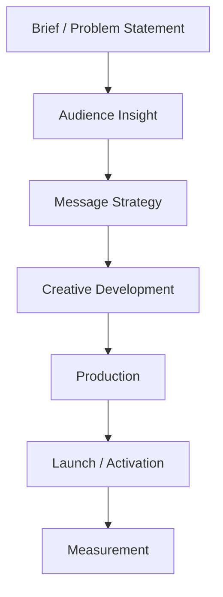
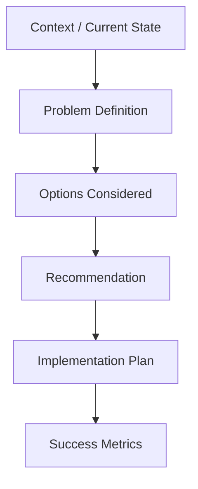
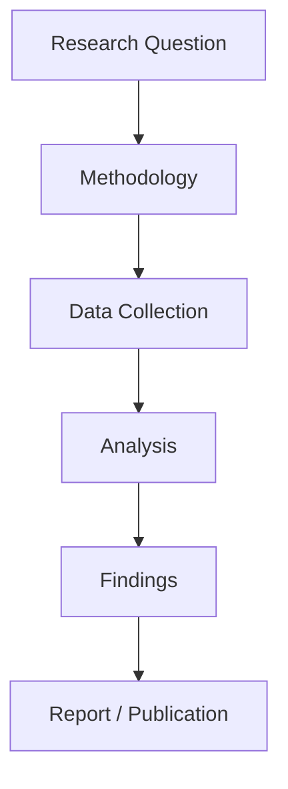
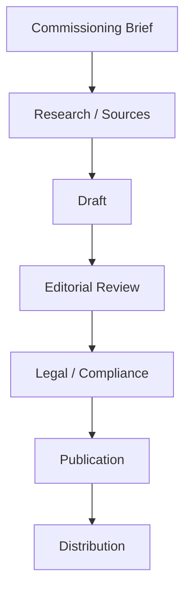

# Visual Guide Patterns

Reference for producing colour-coded flow diagrams and HTML crib sheets
from Project X-Ray analysis.

---

## Decision: When to Generate a Visual

**Generate without asking:**
- Project has four or more distinct layers or subsystems
- Link register is too complex for the table alone to convey
- User explicitly requests it ("something visual", "a diagram", "a crib sheet", "one-pager")
- User is preparing a team handover, not reading for themselves

**Ask first:**
- Project has three or fewer clear layers
- The Mermaid diagram in Section 4 already covers it

**Do not generate:**
- Simple two-layer script or CLI tool
- Single-file submission

Add noise only where it removes noise.

---

## Colour Convention Table

Keep consistent within a single diagram. Adjust groupings to match the actual project
if it has unusual subsystems — the colour principle is visual separation of function, not
strict adherence to this list.

| Layer or type | Colour (hex) | Label | Use for |
|---|---|---|---|
| Entry point | `#1a73e8` | Blue | main, index, app, run, start, server, cli, boot |
| Configuration | `#f9ab00` | Amber | .env, yaml config, toml, ini, settings, feature flags |
| Database or storage | `#34a853` | Green | models, migrations, ORM, SQL, schemas, file storage |
| API or routes | `#9c27b0` | Purple | routes, controllers, endpoints, REST, GraphQL, RPC |
| UI or templates | `#ea4335` | Red | views, templates, pages, components, static |
| Background or jobs | `#ff6d00` | Orange | workers, cron, queues, tasks, scheduled jobs |
| Tests | `#78909c` | Grey | test folders, spec files, fixtures |
| Build or deploy | `#00acc1` | Teal | Dockerfile, CI, Makefile, build scripts, release |
| External services | `#8d6e63` | Brown | third-party APIs, external DB, auth providers, webhooks |
| Automation or workflow | `#7b1fa2` | Deep purple | n8n, Home Assistant, Node-RED, ESPHome |
| Unknown or unclear | `#bdbdbd` | Light grey | anything not confirmed — use sparingly |

---

## Section Reference Numbers

Number links in the visual should point to the corresponding section in the full X-Ray report.
Write numbers as superscripts on node cards.

| Visual element | Links to section |
|---|---|
| Entry point node | §7 Execution Flow |
| Config node | §2 Level Two / §8 Technical Guide |
| Database node | §6 Database Map |
| API / routes node | §3 Capability Inventory |
| UI node | §3 Capability Inventory |
| Background jobs node | §3 Capability Inventory |
| Deploy / build node | §11 README Summary |
| Risk indicators | §10 Risk Audit |

---

## HTML Crib Sheet Template

Adjust nodes, colours, and section references to match the actual project.
Remove nodes that do not exist. Add nodes for unusual subsystems.

```html
<!DOCTYPE html>
<html lang="en">
<head>
<meta charset="UTF-8">
<title>Project X-Ray — Crib Sheet</title>
<style>
  *, *::before, *::after { box-sizing: border-box; }
  body {
    font-family: system-ui, -apple-system, sans-serif;
    background: #f0f2f5;
    padding: 2rem;
    margin: 0;
    color: #1a1a1a;
  }
  h1 { font-size: 1.15rem; color: #1a1a1a; margin: 0 0 0.2rem; }
  .meta { font-size: 0.8rem; color: #666; margin-bottom: 1.5rem; }
  .verdict {
    background: #fff;
    border-left: 4px solid #1a73e8;
    padding: 0.6rem 1rem;
    font-size: 0.85rem;
    border-radius: 0 6px 6px 0;
    margin-bottom: 1.5rem;
    color: #333;
  }
  .map {
    display: flex;
    flex-wrap: wrap;
    gap: 0.85rem;
    align-items: flex-start;
  }
  .node {
    border-radius: 8px;
    padding: 0.7rem 0.9rem;
    color: #fff;
    font-size: 0.82rem;
    min-width: 150px;
    max-width: 210px;
    position: relative;
    box-shadow: 0 1px 4px rgba(0,0,0,0.15);
  }
  .node strong {
    display: block;
    font-size: 0.9rem;
    margin-bottom: 0.3rem;
    letter-spacing: 0.01em;
  }
  .node .files {
    font-size: 0.72rem;
    opacity: 0.88;
    line-height: 1.4;
  }
  .node .ref {
    position: absolute;
    top: -0.55rem;
    right: -0.55rem;
    background: #fff;
    color: #333;
    border-radius: 50%;
    width: 1.35rem;
    height: 1.35rem;
    text-align: center;
    line-height: 1.35rem;
    font-size: 0.65rem;
    font-weight: 700;
    border: 1.5px solid #ccc;
    box-shadow: 0 1px 3px rgba(0,0,0,0.1);
  }
  .risk-banner {
    background: #fce8e6;
    border-left: 4px solid #c62828;
    padding: 0.6rem 1rem;
    font-size: 0.82rem;
    border-radius: 0 6px 6px 0;
    margin: 1.5rem 0 0.5rem;
    color: #c62828;
  }
  .legend {
    margin-top: 1.5rem;
    font-size: 0.77rem;
    color: #555;
    display: flex;
    flex-wrap: wrap;
    gap: 0.3rem 1rem;
  }
  .legend-item {
    display: inline-flex;
    align-items: center;
    gap: 0.4rem;
  }
  .swatch {
    width: 11px;
    height: 11px;
    border-radius: 3px;
    display: inline-block;
    flex-shrink: 0;
  }
  .note {
    background: #fff;
    border: 1px solid #e0e0e0;
    padding: 0.5rem 1rem;
    margin-top: 1.5rem;
    font-size: 0.77rem;
    color: #666;
    border-radius: 6px;
  }
</style>
</head>
<body>

<h1>PROJECT NAME — Project X-Ray Crib Sheet</h1>
<p class="meta">Generated by Project X-Ray · TABARC-Code · § numbers link to report sections</p>

<div class="verdict">
  <strong>Verdict:</strong> [One-sentence verdict from Section 0 goes here]
</div>

<div class="map">

  <div class="node" style="background:#1a73e8;">
    <div class="ref">§7</div>
    <strong>Entry Point</strong>
    <div class="files">main.py · app.js · index.php</div>
  </div>

  <div class="node" style="background:#f9ab00; color:#1a1a1a;">
    <div class="ref">§8</div>
    <strong>Configuration</strong>
    <div class="files">.env · config.yaml · settings.py</div>
  </div>

  <div class="node" style="background:#34a853;">
    <div class="ref">§6</div>
    <strong>Database</strong>
    <div class="files">models/ · migrations/ · schema.sql</div>
  </div>

  <div class="node" style="background:#9c27b0;">
    <div class="ref">§3</div>
    <strong>API / Routes</strong>
    <div class="files">routes/ · controllers/ · api/</div>
  </div>

  <div class="node" style="background:#ea4335;">
    <div class="ref">§3</div>
    <strong>UI / Templates</strong>
    <div class="files">templates/ · views/ · components/</div>
  </div>

  <div class="node" style="background:#ff6d00;">
    <div class="ref">§3</div>
    <strong>Background Jobs</strong>
    <div class="files">workers/ · cron/ · tasks/</div>
  </div>

  <div class="node" style="background:#00acc1;">
    <div class="ref">§11</div>
    <strong>Build / Deploy</strong>
    <div class="files">Dockerfile · .github/ · Makefile</div>
  </div>

  <div class="node" style="background:#8d6e63;">
    <div class="ref">§3</div>
    <strong>External Services</strong>
    <div class="files">stripe · sendgrid · s3 · oauth</div>
  </div>

  <!-- Risk indicator — only include if Critical risks exist in Section 10 -->
  <!--
  <div class="node" style="background:#c62828;">
    <div class="ref">§10</div>
    <strong>⚠ Critical Risk</strong>
    <div class="files">[brief description]</div>
  </div>
  -->

</div>

<!-- Uncomment and populate if Critical risks exist -->
<!--
<div class="risk-banner">
  ⚠ <strong>Critical:</strong> [brief risk description — see §10 for detail]
</div>
-->

<div class="legend">
  <div class="legend-item"><span class="swatch" style="background:#1a73e8;"></span> Entry point</div>
  <div class="legend-item"><span class="swatch" style="background:#f9ab00;"></span> Config</div>
  <div class="legend-item"><span class="swatch" style="background:#34a853;"></span> Database</div>
  <div class="legend-item"><span class="swatch" style="background:#9c27b0;"></span> API / Routes</div>
  <div class="legend-item"><span class="swatch" style="background:#ea4335;"></span> UI</div>
  <div class="legend-item"><span class="swatch" style="background:#ff6d00;"></span> Background jobs</div>
  <div class="legend-item"><span class="swatch" style="background:#00acc1;"></span> Build / Deploy</div>
  <div class="legend-item"><span class="swatch" style="background:#8d6e63;"></span> External services</div>
  <div class="legend-item"><span class="swatch" style="background:#7b1fa2;"></span> Automation / workflow</div>
  <div class="legend-item"><span class="swatch" style="background:#bdbdbd;"></span> Unknown</div>
</div>

<div class="note">
  § numbers refer to sections in the full Project X-Ray report.<br>
  Confidence: <strong>High</strong> = code confirmed &nbsp;·&nbsp; <strong>Medium</strong> = inferred from structure &nbsp;·&nbsp; <strong>Low</strong> = naming pattern only
</div>

</body>
</html>
```

---

## Adapting the Template

**Multiple entry points** (web + CLI + cron): show all three as separate blue nodes.

**Automation projects** (n8n, Home Assistant, Node-RED): use deep purple `#7b1fa2` for the
workflow engine node. Entry point becomes the trigger (webhook, schedule, sensor event).
Database becomes the data store or credential vault if present.

**No UI layer**: remove the red node entirely. Do not leave it empty or greyed out.

**Critical risk present**: uncomment the risk indicator node and the risk banner.
Always make risk visible in the visual, not just in the table.

**Very simple projects** (one or two layers): do not generate the HTML crib sheet.
The Mermaid diagram in Section 4 of the report is sufficient.

---

## Non-Software Mermaid Templates

For non-code projects, the default software flowchart is wrong. Use these shapes instead,
adapting to the actual project structure found.

### Campaign or Marketing Project



### Strategy or Business Document



### Research Project



### Editorial / Content Project



**Rule:** If none of these templates match the project type, build the diagram from the
domain map produced in PHASE 2 Lens 3. The Mermaid shape follows the domain flow, not a
template. Templates are starting points, not constraints.

